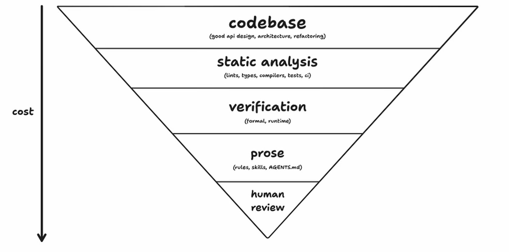

# Case 01 · Screen recording outline

**Target length** — 20 minutes. The case allows up to 30 minutes. Record in English. If Hanna requests Portuguese, keep the same actions, timings, and code identifiers. Useful terms are To Do (*a fazer*), In Progress (*em andamento*), Done (*concluído*), and Undo (*desfazer*).

Before recording, open the app at the Board setup screen, the terminal in the solution directory, and editor tabs for `src/board.ts`, `src/board-screen-state.ts`, `biome.json`, `tests/work-board.spec.ts`, and `src/board.test.ts`. Check the recording text size and that Chromium can launch with `npm run test:e2e`.

## 0:00–2:00 · Open with the trust pyramid

**0:00–1:20 — Show** the pyramid and trace it from Codebase down to Human review.



**Talking points**

- Codex built the board with me. The pyramid is how I checked the delivery. — [README · AI use](../README.md#time-scope-and-ai-use)
- Highest leverage, lowest recurring cost. Pure rules, one reducer, small components. — [`board.ts`](../src/board.ts) · [`board-screen-state.ts` · `boardScreenReducer`](../src/board-screen-state.ts#L16) · [`TaskCard.tsx`](../src/components/TaskCard.tsx#L16)
- Fast checks. Biome and TypeScript. — [`biome.json`](../biome.json) · [`tsconfig.json`](../tsconfig.json#L8)
- Behavior. Playwright for the workflow, Vitest for the rules. — [`work-board.spec.ts` · Undo workflow](../tests/work-board.spec.ts#L17) · [`board.test.ts`](../src/board.test.ts)
- Written intent. Superpowers skills helped turn the brief into a spec, test-first plan, and README. — [Spec](superpowers/specs/2026-11-22-work-board-design.md) · [Test plan](superpowers/plans/2026-11-22-work-board-plan.md) · [README](../README.md)
- Human judgment. Read the diff and ask what the tests prove. — [`work-board.spec.ts` · Undo workflow](../tests/work-board.spec.ts#L17)

**Say** “I built this work board with Codex. I used five layers to decide what I could trust in the delivery. A good codebase gives me the most leverage at the lowest recurring cost. Here, the pure TypeScript board rules, the React reducer, and the small components give the agent a clear place to make changes. I get that benefit on every edit.

“Next, Biome and TypeScript catch code-pattern and type errors. Playwright verifies the user’s workflow, and Vitest isolates the rules. I used the Superpowers skills to turn the brief into a spec, an implementation plan, and failing tests. The spec, test plan, and README record what I asked for and what a reviewer should expect. Human review takes the most focused attention, so I use it to judge decisions and ask whether the tests prove the behavior I care about.”

**1:20–2:00 — Show** Board setup and point to the In Progress limit.

**Talking points**

- Recover from accidental changes. — [Official brief](../casos/01-quadro-de-trabalho.md#L11)
- Browser-only session. New tasks start in To Do. — [`App.tsx` · `App`](../src/App.tsx#L5) · [`board.ts` · `createTask`](../src/board.ts#L60)
- Fixed In Progress limit. Undo reverses the last successful change. — [`SetupForm.tsx` · `SetupForm`](../src/components/SetupForm.tsx#L5) · [`board.ts` · `undo`](../src/board.ts#L93)
- Set up the demo question. What does Undo do after a rejected move? — [`work-board.spec.ts` · Undo workflow](../tests/work-board.spec.ts#L17)

**Say** “The case asks for a work board that can recover from accidental changes. Tasks start in To Do, In Progress has a fixed limit for the session, and Undo reverses the last change that actually happened. This is a browser-only app, so I can show the rules directly. Watch what happens on the first Undo after a rejected move.”

## 2:00–7:00 · Live demo

**Show** the setup and board, with the action feedback and capacity count in view.

**Talking points**

- Set limit to 1. Add Docs (`DOC-01`), then Review (`REV-02`). — [`work-board.spec.ts` · setup and creation](../tests/work-board.spec.ts#L19)
- Move Review to In Progress. Show 1/1 and Undo available. — [`work-board.spec.ts` · Review fills the slot](../tests/work-board.spec.ts#L36)
- Predict the Docs rejection before clicking Move. Point to the message and both cards. — [`work-board.spec.ts` · Docs rejection](../tests/work-board.spec.ts#L39) · [`ActionFeedback.tsx` · `ActionFeedback`](../src/components/ActionFeedback.tsx#L24)
- Predict Undo #1. Review returns to To Do and frees the slot. — [`work-board.spec.ts` · Undo move](../tests/work-board.spec.ts#L44)
- Predict Undo #2. Review disappears and Docs stays. — [`work-board.spec.ts` · Undo creation](../tests/work-board.spec.ts#L49)
- Optional Undo #3. Docs disappears and Undo is disabled. — [`work-board.spec.ts` · empty history](../tests/work-board.spec.ts#L53) · [`board.ts` · `canUndo`](../src/board.ts#L44)

| Action | What to say |
| --- | --- |
| Choose a limit of **1**, click **Start board**, and add `DOC-01` Docs followed by `REV-02` Review. | “Both start in To Do in ID order. Undo becomes available after the first creation.” |
| Move Review to In Progress. | “Review uses the only slot. The counter now reads one of one.” |
| Before selecting In Progress on Docs and clicking **Move** | “I expect a rejection because the slot is occupied. Docs should stay in To Do and Review should stay in In Progress.” After clicking, point to the failure message and both cards. |
| Before the first **Undo** | “I expect Review to return to To Do. The rejected move should have left history alone.” After clicking, show both cards in To Do and the zero-of-one count. |
| Before the second **Undo** | “The preceding action was creating Review. I expect Review to disappear and Docs to remain.” After clicking, point to the remaining Docs card and the creation Undo message. |
| Optional third **Undo**, if time allows | “This removes Docs, the first creation. Now history is empty and Undo is disabled.” |

## 7:00–12:00 · Codebase layer

**Show** `src/board.ts` at `Board`, `InverseAction`, `moveTask`, `commit`, and `undo`. Then show `src/board-screen-state.ts` at `boardScreenReducer`, `src/components/ActionFeedback.tsx` for the live status region, and `src/components/BoardScreen.tsx` for the Undo button. Point out the Tailwind utilities on a task card and the shared theme tokens.

**Talking points**

- Follow one action. React reducer → `applyAction` → board and feedback. — [`board-screen-state.ts` · `boardScreenReducer`](../src/board-screen-state.ts#L16) · [`board.ts` · `applyAction`](../src/board.ts#L106)
- Guard order. Validate inputs, handle same-column moves, then check capacity. — [`board.ts` · `moveTask`](../src/board.ts#L75)
- Successful changes append one inverse. Rejections and no-ops keep history intact. — [`board.ts` · `commit`](../src/board.ts#L52) · [`board.ts` · `moveTask`](../src/board.ts#L75)
- Undo pops the latest inverse. Restore a column or remove a creation. — [`board.ts` · `undo`](../src/board.ts#L93)
- Pure domain rules and small UI components give Codex a clear place to edit. — [`board.ts` · `applyAction`](../src/board.ts#L106) · [`TaskCard.tsx` · `TaskCard`](../src/components/TaskCard.tsx#L16)
- Tailwind styles the components. Vite compiles the utilities and the theme holds the shared colors and font. — [`vite.config.ts`](../vite.config.ts) · [`tailwind.css` · theme](../src/tailwind.css#L5) · [`TaskCard.tsx` · card utilities](../src/components/TaskCard.tsx#L24)

**Say** “The board carries the tasks, the fixed limit, and a stack of inverse actions. A move validates the task and destination, then checks whether the destination is already the current column. Only a move entering In Progress checks capacity. A successful change uses `commit` to produce a new board and append the inverse. Failure and no change return the existing board. Undo pops the last inverse and either removes a creation or restores a column. A LIFO restore returns to a previously valid state.”

“In React, the reducer sends actions through `applyAction`. Each component has a focused responsibility and the UI turns the result into English feedback. Tailwind puts the styling utilities beside the markup, and Vite compiles them with the shared theme. The domain stays pure, so Codex can change a UI component without having to touch the board rules. The three column IDs and the empty Undo code retain the case literals.”

## 12:00–17:00 · Static analysis and verification layers

**12:00–13:30** — Show `biome.json`, the custom Biome rule, and strict mode in `tsconfig.json`. Run:

```sh
npm run lint
npm run typecheck
```

**Talking points**

- Run `npm run lint` and `npm run typecheck`. — [`package.json` · scripts](../package.json#L7)
- Biome catches conditional hooks and nested components. Codex tried both in a scratch snippet. — [`biome.json` · React rules](../biome.json#L14)
- Custom rule. Reading `localStorage` in the board domain fails lint. Biome applies the plugin only to `src/board.ts`. — [`board-no-browser-globals.grit`](../lint/board-no-browser-globals.grit) · [`biome.json` · plugin scope](../biome.json#L3)
- Strict TypeScript checks action and outcome types between modules. — [`tsconfig.json` · strict](../tsconfig.json#L8) · [`board.ts` · `Action` and `Outcome`](../src/board.ts#L16)

**Say** “Biome checks code patterns, including React’s hook rules and components defined inside other components. Codex verified that it rejects both in a small throwaway snippet. TypeScript checks contracts between modules, such as what a board action accepts. Both checks run without starting the browser. We also wrote one project-specific rule. If an agent adds a read from browser storage inside the board module, Biome flags it before the app runs. The rule names the boundary and tells us to pass data in as an argument.”

If time allows, use the [scratch lint demo](#optional-custom-lint-demo) to show the actual diagnostic.

**13:30–17:00** — Show the Playwright test at its failure-message and Undo assertions, then run:

```sh
npm run test:e2e -- -g 'Undo skips'
npm test -- -t 'same-column move at capacity'
```

**Talking points**

- Playwright. Docs stays put, Undo #1 restores Review, Undo #2 removes it. — [`work-board.spec.ts` · Undo workflow](../tests/work-board.spec.ts#L17)
- Vitest. At capacity, a same-column move is a no-op and history stays intact. — [`board.test.ts` · same-column no-op](../src/board.test.ts#L65)
- Show the terminal results. One targeted test passes per command. — [`work-board.spec.ts` · Undo workflow](../tests/work-board.spec.ts#L17) · [`board.test.ts` · same-column no-op](../src/board.test.ts#L65)
- Optional. Show the GitHub Actions run for the submission commit on `main`. — [`checks.yml` · workflow](../.github/workflows/checks.yml)

**Say** “Playwright checks that Docs remains in To Do after the rejection. The first Undo puts Review back and releases the capacity slot. The second removes Review while keeping Docs. These assertions exercise the UI, reducer, and history together. The targeted Vitest case isolates the full-column no-op. It checks the outcome, the original board identity, and the next Undo.”

Show each test’s actual runner output. The expected result is one passing test per command. In the full verification run, Vitest passed 27 checks and Playwright passed both Chromium scenarios.

If time allows, show the GitHub Actions run for the submitted commit. It repeats the static checks, build, Vitest, and Chromium Playwright on each push to `main`.

## 17:00–20:00 · Decisions, scope, and human review

**17:00–18:00 — Show** the decision notes in the README, then return to `undo` and `moveTask` in the editor.

**Talking points**

- Inverse actions keep history entries small. Snapshots simplify complex restores. — [`board.ts` · `InverseAction`](../src/board.ts#L5) · [README · Investigated decisions](../README.md#two-investigated-decisions)
- All three Undos matched the prior task collections in the comparison. — [README · Investigated decisions](../README.md#two-investigated-decisions) · [`board.test.ts` · restore prior boards](../src/board.test.ts#L116)
- Reversing the guards broke the full-column no-op test. Restoring the order fixed it. — [`board.ts` · `moveTask`](../src/board.ts#L75) · [`board.test.ts` · same-column no-op](../src/board.test.ts#L65)

**Say** “I compared the inverse-action results with snapshots of the same sequence. All three Undos matched the previous task collections. Inverse actions keep each record small and explicit. They do require a reversal for each supported operation. Snapshots would be easier to reason about if future actions changed many fields at once.”

“I also tried checking capacity before the same-column guard. The unit test then failed by reporting a capacity error for a move that left occupancy unchanged. Putting the same-column check first restored the expected result.”

**18:00–18:45 — Show** the `useMemo` in `src/components/BoardScreen.tsx`. Point out that it reuses the sorted columns while the board state stays the same.

**Talking points**

- One `useMemo` reuses the sorted columns while board state stays the same. — [`BoardScreen.tsx` · `columnTasks`](../src/components/BoardScreen.tsx#L13)
- React Compiler automates memoization. Profile a larger workload before adding the build step. — [`BoardScreen.tsx` · `columnTasks`](../src/components/BoardScreen.tsx#L13)
- Scope. One user, in-memory session, Undo, and reset on refresh. — [`App.tsx` · `App`](../src/App.tsx#L5) · [`work-board.spec.ts` · refresh reset](../tests/work-board.spec.ts#L93)
- Outside the exercise. Accounts, live collaboration, persistence, deletion, and Redo. — [Official brief · scope](../casos/01-quadro-de-trabalho.md#L23)

**Say** “I kept the existing Vite build and used one `useMemo` for column sorting. React Compiler can automate memoization, but it adds a build step. For this small board, I’d profile a larger workload before adding it. The exercise covers a single-person, in-memory session. Refresh resets the board, and the history supports Undo. Accounts, real-time collaboration, persistent storage, standalone deletion, and Redo are outside the exercise.”

**18:45–20:00 — Show** the spec’s acceptance table and the task list in `BoardColumn.tsx` and the marker utility in `TaskCard.tsx`.

**Talking points**

- AI comments go stale, get skimmed, and can become an escape hatch.
- Concrete example. Transparent native list markers replaced the ARIA role and lint suppression. — [`BoardColumn.tsx` · task list](../src/components/BoardColumn.tsx) · [`TaskCard.tsx` · list markers](../src/components/TaskCard.tsx)
- Put intent in the spec. Express behavior through names and tests. — [Spec](superpowers/specs/2026-11-22-work-board-design.md) · [`work-board.spec.ts` · Undo workflow](../tests/work-board.spec.ts#L17)

**Say** “My default is to ban comments written by or for coding agents. They go stale, humans skim past them, and a suppression comment can become an escape hatch that lets an agent justify a bad pattern. Here, I restored the native list markers and used Tailwind’s `marker:text-transparent` utility to hide them visually. That let me remove the redundant ARIA role and its lint suppression while preserving the list structure. I keep requirements and rationale in the spec and use clear names and tests to express behavior.”

**Show** one relevant diff or test assertion. Use the table as a cue sheet. Close on how you reviewed the assertions or decisions, since the first three layers have already appeared on screen.

**Talking points**

- Show one diff or assertion you personally reviewed. — [`work-board.spec.ts` · first Undo assertion](../tests/work-board.spec.ts#L44)
- Tie it to the brief. Predict the outcome, run the demo, and check what the test proves. — [Official brief](../casos/01-quadro-de-trabalho.md#L11) · [`work-board.spec.ts` · Undo workflow](../tests/work-board.spec.ts#L17)
- Use the full pyramid recap if time allows.

| Layer | What to show | What to say |
| --- | --- | --- |
| Codebase | The pure board module, reducer, and dedicated component files | “The domain boundary and existing patterns give the coding agent a clear place to make each change.” |
| Static analysis | Biome and strict TypeScript | “These give fast feedback on invalid patterns and type errors before I run the app.” |
| Verification | Playwright’s rejected move and two Undos, with Vitest as the domain-level complement | “Playwright shows whether the user’s workflow actually works. Vitest isolates edge cases like moving within a full column.” |
| Prose | Spec, test plan, and README | “I gave Codex the brief and acceptance criteria, then asked it for a focused implementation with test evidence. The same artifact-based workflow would work with Claude Code.” |
| Human review | The capacity guard and the two Undo assertions | “I would read the diff against the brief, predict and rerun the demo, and check whether the assertions prove the intended behavior.” |

For the recording, use “I reviewed” only after doing that pass yourself. Codex was the agent used for this project.

Keep the repository link, full commit hash, recording link, and time spent handy for your submission.

## Optional custom lint demo

Run from the repository root after `npm ci`. This uses the project’s config and rule in a temporary directory.

```sh
board_biome="$PWD/node_modules/.bin/biome"
board_lint_demo=$(mktemp -d)
cp biome.json "$board_lint_demo/"
cp -R lint "$board_lint_demo/"
mkdir "$board_lint_demo/src"
printf '%s\n' "export const lastBoard = localStorage.getItem('board')" > "$board_lint_demo/src/board.ts"
(cd "$board_lint_demo" && "$board_biome" lint src/board.ts)
```

Biome should exit with an error highlighting `localStorage`. Move the same scratch file to `src/main.ts` inside the temporary directory and lint that path to show the file scope. The rule checks direct references to the named objects. Pure domain behavior also depends on code review and tests.
